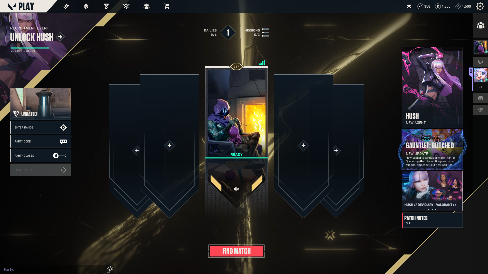
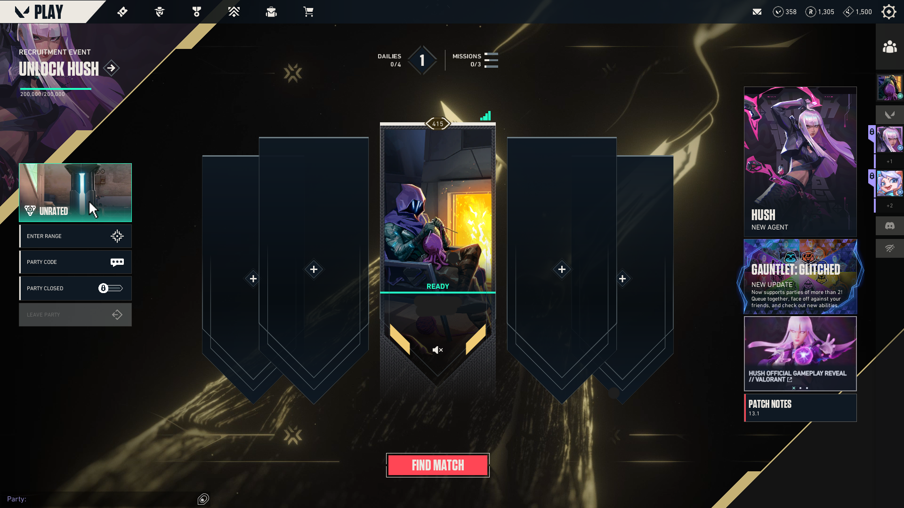
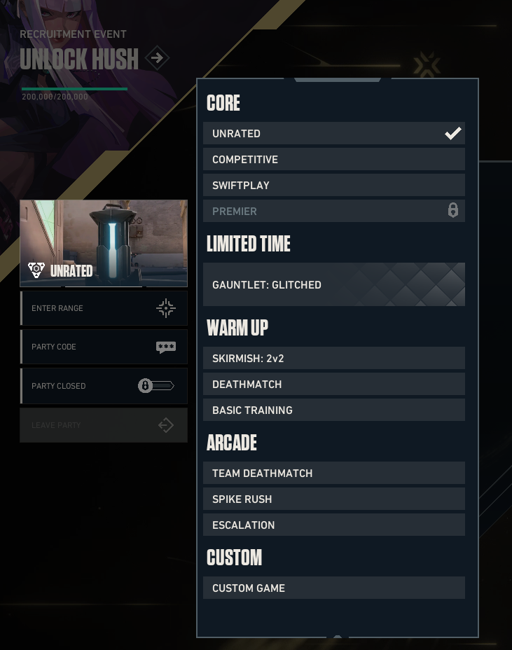

# Adjusting to VALORANT's New Lobby

After Valorant’s new update I decided I wanted to get on and play some matches of competitive due to the new season starting as well. As Valorant was opening up I was preparing to click on the competitive game mode which would usually be on option near the top of the screen. Before the update, the different game modes were listed horizontally across the top allowing you to click on whichever one you wanted to play. However, I quickly realized that the game modes were not listed there anymore. 

I then realized I had to figure out where they had moved the options for game modes. Even though I could tell that I was already on the lobby page, I clicked the big Play button in the top-left corner of the screen. I thought that maybe the update had changed it so that you had to click Play before the game mode options would appear. After clicking it, nothing seemed to happen, so I realized I would have to explore the new lobby myself to figure out where the game modes had moved.

The reason I immediately looked at the top of the screen and then tried the Play button was because of my mental model of how I expected the game to work. A **mental model** is the understanding or expectation someone develops about how something works based on their previous experiences. Since I wanted to play a match I thought clicking the button labeled "Play" seemed like the most sense place to find my options for starting one. As I started exploring the lobby I noticed an image with labeled "Unrated.” When I hovered my mouse over the image it lit up and slightly moved. This was an example of an **affordance**, which is a clue in a design that helps a user understand how they can interact with something. The movement made me think that the image could be clicked, so I clicked on it and finally found where all of the game modes had been moved.

As a returning player getting adjusted to the new UI was difficult and a little frustrating because I was already so used to the previous one. The old UI felt quick and simple to me, but that does not mean the new one is not. I still miss the old UI especially since I have been playing VALORANT for almost as long as the game has been released. However, I understand why this change was made because new game modes have been added over time. If every game mode continued to be listed horizontally across the top of the lobby the page could easily become cluttered.
